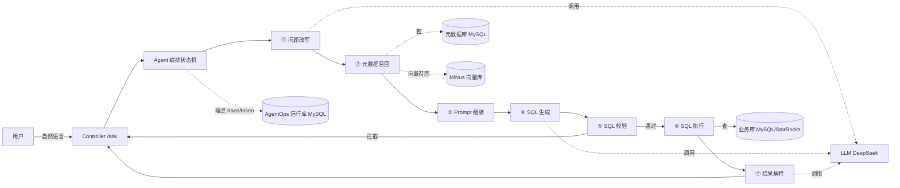

# DataPilot 技术方案设计文档

| 项 | 内容 |
|---|---|
| 文档版本 | v0.1 |
| 更新日期 | 2026-10-16 |
| 作者 | 张灵枫 |
| 关联文档 | PRD v0.1 |

---

## 1. 技术选型（定稿）

| 层 | 选型 | 理由 |
|---|---|---|
| 语言 | Java 17 | 大数据/后端生态主语言，补齐后端短板 |
| 框架 | Spring Boot 3.4.8 | 最小依赖，Web + JDBC 即可 |
| 元数据库 | MySQL | 存语义模型/字段/指标/术语，关系型最自然 |
| 业务数据引擎 | MySQL / StarRocks（预留 Excel，可插拔） | 复用数仓强项；异构源统一成 SQL 入口 |
| LLM | DeepSeek（OpenAI 兼容） | 非推理模型，无 think 污染，便宜够用 |
| Embedding | OpenAI 兼容（Qwen text-embedding-v3） | 元数据向量化，国内可达，可切换 |
| 向量数据库 | Milvus 2.x（Docker Standalone） | 元数据语义检索，对标 DataAgent RAG |
| Agent 编排 | 手写状态机 | 借鉴 StateGraph 思想，讲得深、依赖最少 |
| HTTP 客户端 | RestClient | Spring 6 内置，无需额外依赖 |
| 前端 | 极简 HTML | 演示够用，不铺 Nuxt |
| Agent 可观测性 | 自研轻量 AgentOps（对齐 AgentOps-AI/agentops span 层级） | 差异化亮点；Java 栈自研比引 Python SDK 更能讲深 |

**与 DataAgent 选型对照**：DataAgent 用 Spring AI Alibaba + StateGraph + 向量库 + Python 沙盒 + Nuxt 前端；DataPilot 用 Spring Boot 裸框架 + 手写状态机 + Milvus 向量检索（同款）+ 结果解释（替代沙盒）+ 极简 HTML（替代 Nuxt）。同款保留：Java 17 / Spring Boot 3.4.8 / MySQL / DeepSeek / 向量检索。核心差异：砍掉"重工程"（Python 沙盒/MCP/API Key），保留"重数据 + 重检索"（语义层/口径/SQL 治理/RAG）。

---

## 2. 架构总览



**一句话**：Controller 收问题 → 状态机串 7 个节点 → 节点间通过 `AgentContext` 传递状态 → 执行结果经 LLM 解释后返回。

---

## 3. 模块划分（对应代码包结构）

```
com.zlf.datapilot
├── controller/    # REST 入口，收问题、返回结论
├── agent/         # 编排核心：AgentStep 接口 + AgentContext 状态 + 7 个节点实现
├── knowledge/     # 元数据层：语义模型/字段/指标/术语的 CRUD + 召回
├── llm/           # LLM 客户端：OpenAI 兼容对话接口 + DeepSeek 实现
└── sql/           # SQL 引擎：SqlExecutor 接口 + MySQL/StarRocks 实现 + 校验器
```

**职责边界**（面试会问"为什么这么拆"）：
- `agent` 只关心"流程怎么走"，不关心"表长啥样""SQL 怎么执行"
- `knowledge` 只关心"元数据在哪、怎么召回"，不碰 LLM
- `sql` 只关心"SQL 能不能跑、怎么跑"，不做业务
- 每个包依赖单向，不交叉 → 换引擎/换 LLM/换节点都不动别人

---

## 4. 核心数据流（7 步链路）

| 节点 | 输入 | 输出 | 依赖 |
|---|---|---|---|
| ① 问题改写 | 原始问题 | 规范化问题 | LLM |
| ② 元数据召回 | 规范化问题 | 相关表 + 字段 + 指标 | 元数据库 |
| ③ Prompt 组装 | 问题 + 元数据 | 完整 Prompt | —— |
| ④ SQL 生成 | Prompt | SQL | LLM |
| ⑤ SQL 校验 | SQL | 通过/拦截 | —— |
| ⑥ SQL 执行 | SQL | 结果集 | 业务库 |
| ⑦ 结果解释 | 结果集 + 问题 | 人话结论 | LLM |

**状态传递**：所有节点读同一个 `AgentContext` 对象，改完传下去（状态机思想的核心）。

---

## 5. 关键设计决策（为什么这么选，面试重点）

### 5.1 为什么手写状态机，不用 Spring AI Graph
- 5 天周期调 Spring AI Graph 只能"会用"，被问"节点状态怎么序列化、图和顺序执行的区别"就露馅。
- 手写状态机能讲清本质：状态在节点间流转 + 失败重试 + 条件分支，这些是我自己实现的，讲得深。

### 5.2 为什么做「双轴可插拔」

"可插拔"是两个维度，缺一不可：

| 维度 | 插拔什么 | 对应接口 | 例子 |
|---|---|---|---|
| 能力轴 | Agent 会干什么 | `AgentStep`（Skill） | 查元数据 / 生成SQL / 画图 / 导出 |
| 数据源轴 | Agent 从哪取数 | `SqlExecutor`（DataSource） | MySQL / StarRocks / Excel / CSV |

**数据源轴的难点：异构引擎怎么统一。** MySQL/StarRocks 本身是 SQL 引擎，`query(sql)` 天然成立；但 Excel 是文件、不是数据库。解法是把 Excel "伪装"成 SQL 引擎——内部用 DuckDB 直接 `SELECT * FROM 'xxx.xlsx'`，对外暴露同一个 `query()` 入口。

**接口设计（统一"取数"和"元数据召回"两个能力）：**

```java
public interface SqlExecutor {
    String engineName();
    List<TableMeta> listTables();              // 支撑第②步元数据召回
    List<Map<String, Object>> query(String sql);
}
```

- MySQL/StarRocks 实现：`listTables()` 查 information_schema。
- Excel 实现：`listTables()` 解析 sheet 名和表头，`query()` 内部转 DuckDB。

**这一设计的本质是「统一数据访问层 / Query Federation」**——Presto/Trino 做的就是"一个 SQL 入口插一堆异构数据源"。首版先实现 MySQL + StarRocks，Excel 作为接口预留的扩展点。

### 5.3 为什么元数据存 MySQL，不用 StarRocks
- 元数据是"关系型小数据"（表/字段/指标/术语），需要精确查询、唯一约束、事务。
- StarRocks 是 OLAP，强在聚合大表，不适合存元数据。元数据与业务数据分离，是架构常识。

### 5.4 为什么 SQL 校验放执行前，而不是执行后
- 安全第一：只读白名单 + 表白名单 + LIMIT，在 LLM 生成 SQL 后、执行前拦截。
- 对应 PRD 的核心痛点"裸调 LLM 生成的 SQL 越权/注入"，校验器是这道防线。

### 5.5 为什么 RAG 选 Milvus 向量库
- **语义检索 > 关键词匹配**：用户问"成交额"，元数据里写的是"支付金额"，字面不同但语义同。关键词匹配会漏，向量召回能命中。
- **选 Milvus 而非 PGVector/ES**：Milvus 是专业向量库标杆（面试知名度高），向量索引（HNSW/IVF）成熟；PGVector 要引 PostgreSQL、与现有 MySQL 两套库；ES 的向量检索是后加能力。Milvus Standalone 一个 Docker Compose 即起，Java SDK（milvus-sdk-java）成熟。
- **Embedding 用 OpenAI 兼容接口**（Qwen text-embedding-v3），与 LLM 客户端同一套调用方式，可切换。

### 5.6 AgentOps 设计：对齐 AgentOps-AI/agentops 的 span 层级模型
本项目借鉴开源项目 AgentOps-AI/agentops（AI Agent 可观测性标杆）的核心概念，自研轻量落地，而不是直接引其 Python SDK——因为 DataPilot 是 Java 栈，且数据侧自研能讲得更深。

**对齐的核心：span 层级模型。** AgentOps 把一次运行拆成 Session → Workflow → Agent → Operation → Event 五层。DataPilot 映射成两层存储，用 `span_type` 表达层级：

| AgentOps 概念 | DataPilot 落地 | 说明 |
|---|---|---|
| Session（根） | `agent_run` | 一次问数一条 |
| Operation（节点） | `agent_step` + `span_type=operation` | 7 个节点 |
| Event（底层动作） | `agent_step` + `span_type=llm/sql/vector` | LLM 调用 / SQL 执行 / 向量召回 |

**借鉴的四个能力（都是面试亮点）：**

1. **成本管理（workflow pricing）**：AgentOps 会给一次 Agent 运行"定价"。DataPilot 在 `agent_run` 存 `total_cost`（token × 单价），能回答"这个 Agent 一次问数花多少钱"。
2. **失败回放（session replay）**：AgentOps 招牌是 2 行代码回放 session。DataPilot 的 trace 完整记录每步 input/output，天然支持失败回溯与重放。
3. **蜜罐 / 注入检测（honeypot）**：AgentOps 用 PromptArmor 做提示注入检测。DataPilot 的「表名白名单校验」就是同源思想——未登记的"蜜罐表名"一旦被 LLM 生成的 SQL 引用，立即拦截，同时暴露幻觉与注入。
4. **跨 session 指标（summary analytics）**：`agent_run` 按天聚合 token 成本、成功率、平均耗时，即 AgentOps 概览面板的雏形。

**为什么不直接引 AgentOps SDK**：它是 Python SDK，DataPilot 是 Java 栈；且引 SDK 只能"会用"，自研能把"可观测性到底观测什么"讲清，和数仓「事实表」思想无缝咬合。

---

## 6. 数据模型（元数据 5 表 + AgentOps 2 表 + 业务样例表）

| 表 | 作用 | 关键字段 |
|---|---|---|
| `semantic_model` | 可查询的表 | table_name, table_comment, biz_domain |
| `field_metadata` | 字段 + 枚举 | table_name, field_name, field_comment, enum_values |
| `metric_def` | 指标口径（只定义一次） | metric_name, definition |
| `term_dict` | 业务术语同义词 | term, field_ref |
| `few_shot_example` | 问题-SQL 示例对（智能体知识） | question, sql, biz_domain |
| `agent_run` | AgentOps：一次问数运行记录 | trace_id, status, total_latency_ms, total_tokens, final_sql |
| `agent_step` | AgentOps：每个节点执行明细 | trace_id, step_name, step_order, latency_ms, token_used, status |
| `orders` | 业务样例表（演示用） | order_id, channel, sku_id, amount, status, order_time |

完整 DDL 见 `src/main/resources/schema.sql`。

---

## 7. 接口设计（REST）

| 方法 | 路径 | 说明 |
|---|---|---|
| POST | `/api/ask` | 问数：`{"question":"上月销售额是多少","sessionId":"可选"}` |
| GET | `/api/tables` | 列出已登记的语义模型表 |
| POST | `/api/metadata` | 数据管理员维护元数据（表/字段/指标/术语） |
| GET | `/api/traces` | AgentOps：查询历史运行记录（trace 列表 + 节点明细） |

返回结构：
```json
{
  "question": "上月销售额是多少",
  "sql": "SELECT SUM(amount) FROM orders WHERE ...",
  "answer": "上月销售额为 xxx 万元",
  "data": [{"column": "value"}],
  "chartType": "card"
}
```

---

## 8. 里程碑（对应 5 天）

| 天 | 交付 |
|---|---|
| Day 1 | 骨架 + 4 元数据表 + LLM 客户端调通 |
| Day 2 | 元数据 CRUD + 召回 + 问题改写节点 |
| Day 3 | SQL 生成 + 校验 + 执行 |
| Day 4 | 结果解释 + 多轮对话 + 串 7 步 |
| Day 5 | 极简前端 + few-shot + README + 演示 |
